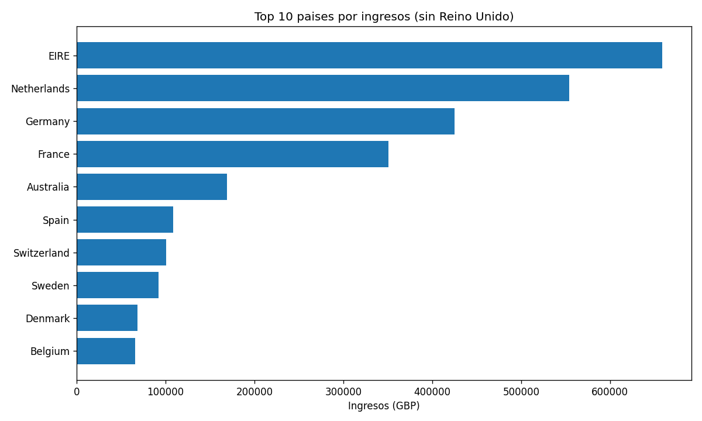
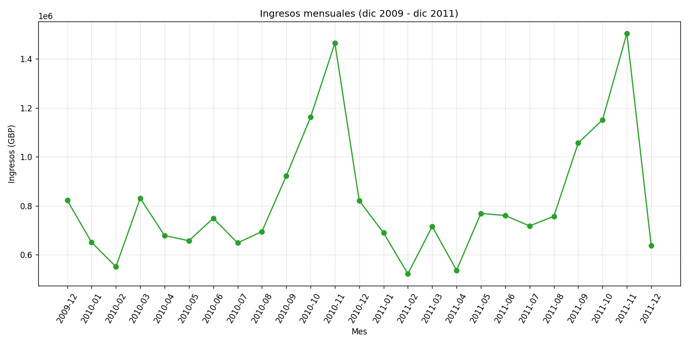
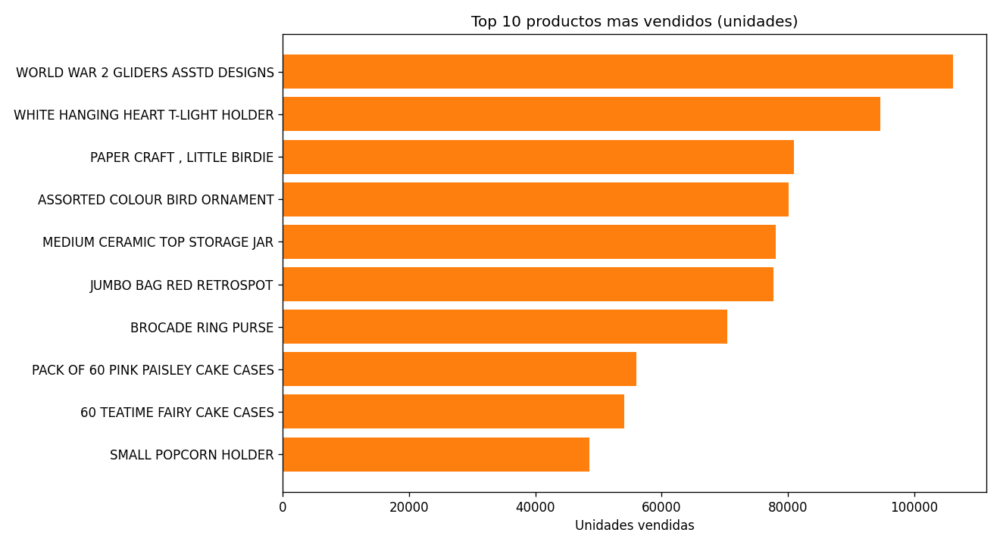
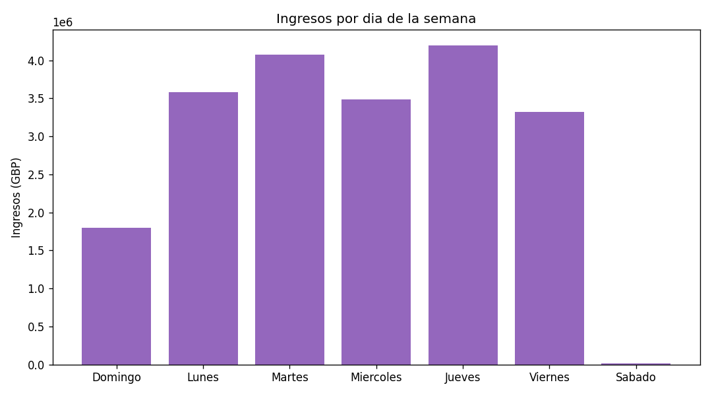
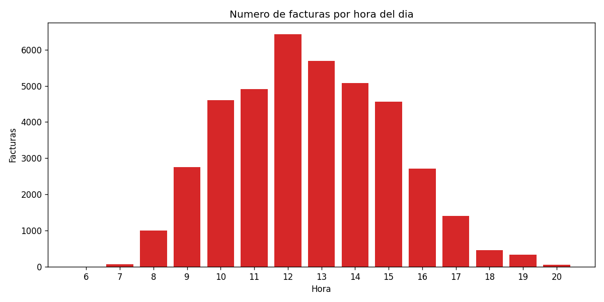
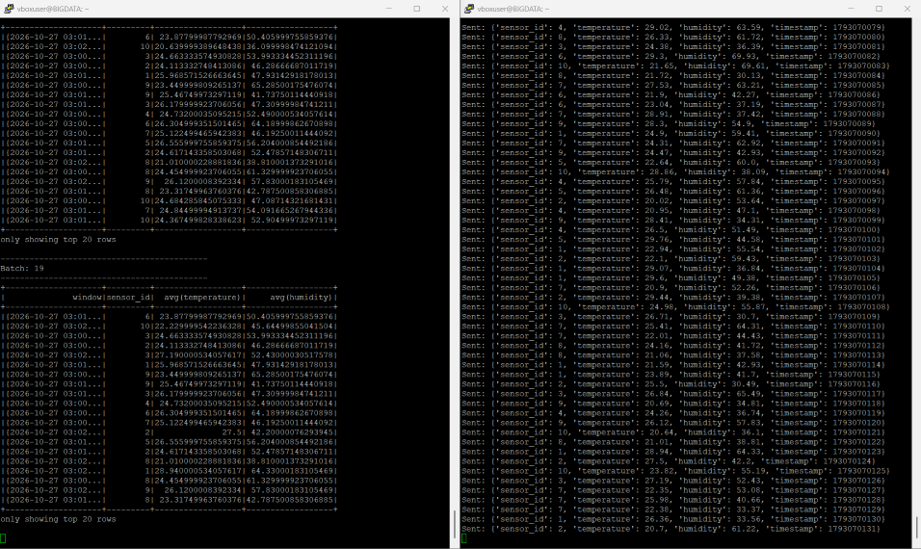

# Tarea 3 – Procesamiento de Datos con Apache Spark y Kafka

**Universidad Nacional Abierta y a Distancia (UNAD)** · Curso Big Data · Grupo 202016911_48
**Estudiante:** Kevin Ortiz · Ingeniería de Sistemas · CCAV Cúcuta
**Tutor:** Fabián Alfredo García Rincón · Octubre de 2026

Análisis en **batch** y en **tiempo real** del dataset *Online Retail II* con Apache Hadoop (HDFS), Apache Spark (PySpark y Structured Streaming) y Apache Kafka.

## Videos de la solución

| Parte | Contenido | Enlace |
|---|---|---|
| 1 | Procesamiento en batch con Spark sobre HDFS | https://youtu.be/xPmXV4lZ6h0 |
| 2 | Tiempo real con Kafka y Spark Streaming | https://youtu.be/Ez4IYWY7yAs |

---

## 1. Planteamiento del problema

Una tienda en línea del Reino Unido, que vende artículos de regalo sobre todo a mayoristas, registró más de un millón de transacciones entre 2009 y 2011. Ese volumen supera la capacidad práctica de herramientas como las hojas de cálculo.

**Pregunta problema:** ¿Qué patrones de ventas por país, producto, temporada y horario revela el historial de la tienda, y cómo se pueden monitorear esas ventas en tiempo real?

## 2. Conjunto de datos

| Aspecto | Detalle |
|---|---|
| Nombre | Online Retail II |
| Fuente original | UCI Machine Learning Repository (Chen, 2012) |
| Descarga (CSV) | https://www.kaggle.com/datasets/mashlyn/online-retail-ii-uci |
| Periodo | 01/12/2009 – 09/12/2011 |
| Registros | 1.067.371 |
| Variables | Invoice, StockCode, Description, Quantity, InvoiceDate, Price, Customer ID, Country |
| Tamaño | 90,46 MB |
| Licencia | CC BY 4.0 |

> El CSV no se incluye en el repositorio por su tamaño. Se descarga desde Kaggle (ver sección 5).

## 3. Arquitectura

```
BATCH
  CSV (Kaggle) ──scp──> HDFS /Tarea3 ──> PySpark (DataFrames + RDD) ──> Matplotlib (5 PNG)

TIEMPO REAL (Anexo 3 adaptado)
  retail_producer.py ──> Kafka 3.9.2 (topic ventas_retail) ──> Spark Structured Streaming ──> Consola + Spark UI :4040
                         ZooKeeper (coordinación)
```

## 4. Estructura del repositorio

```
Tarea3-BigData-Spark-Kafka/
├── README.md
├── requirements.txt
├── batch/
│   └── tarea3.py                        # Carga, limpieza, EDA, RDD y gráficas
├── streaming/
│   ├── anexo3_sensores/                 # Anexo 3 tal como lo indica el instructivo
│   │   ├── kafka_producer.py
│   │   └── spark_streaming_consumer.py
│   └── online_retail/                   # Adaptación a las ventas de Online Retail II
│       ├── retail_producer.py
│       └── retail_streaming_consumer.py
├── graficas/                            # Resultados del análisis batch
└── capturas/                            # Evidencias: HDFS, Spark UI y streaming
```

## 5. Entorno y versiones

| Componente | Versión |
|---|---|
| Sistema operativo (VM) | Ubuntu Server 22.04.5 LTS (VirtualBox) |
| Hadoop | 3.3.6 |
| Apache Spark / PySpark | 3.5.8 (Scala 2.12.18) |
| Java | OpenJDK 11 |
| Apache Kafka | 3.9.2 (Scala 2.12) con ZooKeeper |
| Python | 3.10 · kafka-python 3.0.12 · pandas · matplotlib |

Instalación de librerías Python:

```bash
pip install kafka-python pandas matplotlib
```

## 6. Ejecución

### 6.1 Procesamiento en batch

**a) Llevar el dataset a la VM** (desde Windows PowerShell):

```bash
scp archive.zip hadoop@<IP_VM>:/home/hadoop/
```

**b) Iniciar Hadoop y cargar el CSV a HDFS** (usuario `hadoop`):

```bash
start-all.sh
python3 -m zipfile -e archive.zip .
hdfs dfs -mkdir -p /Tarea3
hdfs dfs -put /home/hadoop/online_retail_II.csv /Tarea3
hdfs dfs -ls /Tarea3
```

**c) Ejecutar el análisis** (usuario `vboxuser`):

```bash
python3 batch/tarea3.py
```

El script lee `hdfs://localhost:9000/Tarea3/online_retail_II.csv`, imprime los resultados en consola y guarda las gráficas en `~/graficas_tarea3`. Al final queda en pausa para revisar la consola web de Spark en `http://<IP_VM>:4040`.

### 6.2 Tiempo real con Kafka y Spark Streaming

**a) Descargar e instalar Kafka 3.9.2**, desde el archivo histórico oficial de Apache:

```bash
wget https://archive.apache.org/dist/kafka/3.9.2/kafka_2.12-3.9.2.tgz
tar -xzf kafka_2.12-3.9.2.tgz
sudo mv kafka_2.12-3.9.2 /opt/Kafka
```

**b) Iniciar ZooKeeper y Kafka:**

```bash
cd /opt/Kafka
sudo bin/zookeeper-server-start.sh config/zookeeper.properties &
sudo bin/kafka-server-start.sh config/server.properties &
cd ~
```

**c) Crear el topic:**

```bash
/opt/Kafka/bin/kafka-topics.sh --create --bootstrap-server localhost:9092 --replication-factor 1 --partitions 1 --topic ventas_retail
```

**d) Ejecutar el productor** (terminal 1). Requiere `online_retail_II.csv` en `/home/vboxuser/`:

```bash
python3 streaming/online_retail/retail_producer.py
```

**e) Ejecutar el consumidor** (terminal 2):

```bash
spark-submit --packages org.apache.spark:spark-sql-kafka-0-10_2.12:3.5.8 --conf spark.sql.shuffle.partitions=4 streaming/online_retail/retail_streaming_consumer.py
```

> Para la versión original del Anexo 3, se crea el topic `sensor_data` y se ejecutan los scripts de `streaming/anexo3_sensores/` con los mismos pasos.

## 7. Resultados del análisis batch

### Calidad de los datos

| Problema | Registros | Tratamiento |
|---|---:|---|
| Sin Customer ID | 243.007 | Se conservan (son ventas válidas) |
| Duplicados | 34.335 | `dropDuplicates()` |
| Cantidad ≤ 0 | 22.950 | Excluidos |
| Facturas canceladas (C) | 19.494 | Excluidas |
| Precio ≤ 0 | 6.207 | Excluidos |
| Sin Description | 4.382 | Excluidos |

Registros limpios: **1.007.913**, es decir, se depuró el 5,57 %.

### Cifras generales

- Ingresos totales: **GBP 20.476.260,43**
- 40.077 facturas · 5.878 clientes · 4.917 productos · 43 países
- El Reino Unido aporta el **85,03 %** de los ingresos

### Gráficas

| | |
|---|---|
|  |  |
|  |  |
|  | |

**Hallazgos principales:**

1. **Mercados:** fuera del Reino Unido, Irlanda (GBP 658.767), Países Bajos y Alemania lideran. Países Bajos promedia unas GBP 2.430 por factura, lo que indica clientes mayoristas.
2. **Estacionalidad:** el pico de ventas se repite cada noviembre (GBP 1,46 M en 2010 y GBP 1,50 M en 2011). Diciembre de 2011 aparece bajo porque los datos terminan el día 9.
3. **Productos:** el portavelas *White Hanging Heart T-Light Holder* es el que más ingresos genera (GBP 260.990). *Paper Craft, Little Birdie* y *Medium Ceramic Top Storage Jar* aparecen inflados por pedidos únicos gigantes que fueron cancelados en el registro original.
4. **Comportamiento B2B:** el 91,2 % de los ingresos ocurre de lunes a viernes, los sábados casi no hay ventas y el 78 % de las facturas se emite entre las 10:00 y las 15:00.
5. **Calidad de datos:** el EDA detectó registros no comerciales (MANUAL, POSTAGE, AMAZON FEE, ajustes contables) que distorsionan los rankings si no se tratan.

## 8. Resultados en tiempo real

El productor reproduce las ventas limpias del CSV, unas 10 por segundo, y Spark Structured Streaming calcula **por país** el número de líneas de venta, las unidades y los ingresos en GBP, en **ventanas de 1 minuto** y con modo de salida `complete`. Con esta arquitectura la tienda podría vigilar en vivo sus mercados en los picos de demanda que identificó el análisis batch.



*Prueba base del Anexo 3 con el topic `sensor_data`.*

## 9. Problemas encontrados y soluciones

| Problema | Solución |
|---|---|
| Kafka 3.9.2 ya no aparece en `downloads.apache.org`, que solo ofrece versiones 4.x, y estas ya no usan ZooKeeper | Descarga desde el archivo histórico oficial `archive.apache.org/dist/kafka/3.9.2/` |
| El instructivo usa el paquete `spark-sql-kafka-0-10_2.12:3.5.3`, pero la VM tiene Spark 3.5.8 | Usar `spark-sql-kafka-0-10_2.12:3.5.8`, que coincide con la versión instalada |
| La VM no obtenía IP en modo puente | Seleccionar en VirtualBox el adaptador de red activo del equipo (USB Ethernet) |
| Comandos largos se partían al copiarlos desde un PDF | Entrar a `/opt/Kafka` y usar rutas relativas más cortas |
| El primer micro-lote del streaming tardaba en una VM de un solo nodo | `--conf spark.sql.shuffle.partitions=4` |
| `vboxuser` no podía leer el CSV ubicado en `/home/hadoop` | Copiar el CSV también a `/home/vboxuser` para el productor |

## 10. Referencias

- Chen, D. (2012). *Online Retail II* [Conjunto de datos]. UCI Machine Learning Repository. https://doi.org/10.24432/C5CG6D
- Mashlyn. (s. f.). *Online Retail II UCI* [Conjunto de datos]. Kaggle. https://www.kaggle.com/datasets/mashlyn/online-retail-ii-uci
- The Apache Software Foundation. (s. f.). *Structured Streaming programming guide* (versión 3.5.8). Apache Spark. https://spark.apache.org/docs/3.5.8/structured-streaming-programming-guide.html
- The Apache Software Foundation. (s. f.). *Apache Kafka documentation* (versión 3.9). https://kafka.apache.org/39/documentation.html
- Universidad Nacional Abierta y a Distancia. (2026). *Anexo 3. Instructivo Spark Streaming y Kafka* [Material del curso Big Data]. UNAD.
